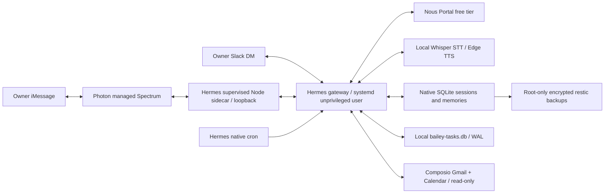

# Architecture

Inspection date: 2026-11-09. The workspace was empty. Official upstream source and
documentation were inspected before implementation. A full shallow clone was
attempted; direct source retrieval was also used because network access was slow
and some GitHub requests were rate-limited. No upstream code is forked or vendored.

## Native functionality reused

Hermes supplies the Python agent loop, model provider/authentication, SQLite session
history, memory tools, SKILL.md loading, scheduling and delivery. Photon is a bundled
platform plugin with a supervised Node Spectrum sidecar, authenticated loopback
transport, sender allowlisting, inbound attachments and voice, outbound media,
and reconnection. No public webhook or Mac relay is needed.

Configuration and native CLI cover identity, memory, Nous Portal OAuth, Photon onboarding,
voice providers, timezone and briefings. Custom code only installs the profile,
validates a restricted configuration, registers native jobs, and supports operations.
No custom agent, messaging adapter, transcription service, scheduler, or session DB.

## Implementation order

1. Preserve the complete request and roadmap; inspect official docs/source.
2. Configure a private profile with SOUL.md and memories/USER.md; text-first voice.
3. Restrict tools to memory, session search, and TTS; deny payment-capable routes.
4. Use official installation and interactive Nous Portal/Photon authentication on the VPS.
5. Register two native cron jobs with explicit Lagos timezone and Photon delivery.
6. Supervise the gateway with systemd, monitor local health and rotate logs.
7. Encrypt off-host backups; document restore and live acceptance evidence.

## Boundaries and assumptions

The owner clarified the intended provider as InstaBox (instabox.sh). The owner selected its free plan, accepting intermittent availability instead of
24/7 operation. Wake/reconnect behavior and persistent storage need validation. See INSTABOX.md. Deployment targets Ubuntu/Debian with systemd and a dedicated `bailey`
user. The owner supplied a number in private local configuration; SSH access and
iMessage capability still need validation. Photon
assigns the assistant's line. A router/data-only number is not assumed to support
iMessage. The free shared-line recipient must initiate a conversation first.

Phase 1 needs no new structured database. Hermes state.db is the source of session
history; the readiness check verifies SQLite integrity and WAL. Phase 2 adds one
local SQLite database (`bailey-tasks.db`, WAL, schema version 1) owned by the
`bailey_tasks` tool, separate from Hermes' agent-worker Kanban and from general
memory. Future financial/reading schemas and all Phases 3–5 remain deferred.
Backups stop the gateway so SQLite and file state are copied consistently,
including WAL sidecars.

## Phase 2 extension

The same Hermes profile loads one reviewed local plugin, `bailey-productivity`,
with three bounded tools:

- `bailey_tasks` — owner-only personal tasks, tentative/confirmed commitments,
  due dates, priorities, completion and daily/weekly/monthly recurrence. It
  schedules no push reminders and dispatches no workers.
- `bailey_accounts` — exactly three read operations: Gmail search, Gmail message
  read and primary-calendar event listing through Composio. Tool slugs and account
  aliases are fixed; ranges require timezone-aware dates and are capped at 93 days.
- `bailey_writes` — immutable write proposals in `bailey-writes.db` (WAL), with
  payload-bound approvals, expiry and at-most-once dispatch. Only the operator CLI
  approves/executes; the model never receives those methods.

Composio OAuth tokens stay in Hermes' native private `mcp-tokens` directory. The
model never receives generic Composio execution, proxy, shell or workbench tools,
and no direct email-send or calendar-mutation tool is exposed. The private operator
CLI can execute reviewed proposals. GitHub and web research remain unimplemented. The
profile policy check resolves the full per-channel tool catalog (CLI, Photon,
Slack, disabled WhatsApp Cloud and cron) before startup and fails closed on drift.
`known_plugin_toolsets` records the custom toolsets so new plugin tools cannot be
enabled silently on cron or a disabled channel.

Policy prompts are defense in depth, not a security boundary. The small tool list,
no MCP/connectors, no payment credentials, and dedicated OS user enforce Phase 1's
boundary. This reduces useful capabilities intentionally; attachments requiring
general file/browser tools are not enabled. Images may require a vision-capable
model; the selected Nous free model is validated for tool calling but is not assumed to be vision-capable.

## Official references

- [Repository](https://github.com/NousResearch/hermes-agent)
- [Installation](https://hermes-agent.nousresearch.com/docs/getting-started/installation)
- [Providers](https://hermes-agent.nousresearch.com/docs/integrations/providers)
- [Photon adapter and setup](https://github.com/NousResearch/hermes-agent/tree/main/plugins/platforms/photon)
- [Voice](https://github.com/NousResearch/hermes-agent/blob/main/website/docs/user-guide/features/tts.md)
- [Memory](https://hermes-agent.nousresearch.com/docs/user-guide/features/memory)
- [Skills](https://hermes-agent.nousresearch.com/docs/user-guide/features/skills)
- [Cron](https://hermes-agent.nousresearch.com/docs/user-guide/features/cron)
- [Configuration](https://hermes-agent.nousresearch.com/docs/user-guide/configuration)
- Source inspected: hermes_cli/config.py, hermes_cli/main.py, gateway/run.py,
  toolsets.py, hermes_cli/tools_config.py, hermes_cli/cron.py, tools/cronjob_tools.py,
  Photon adapter/CLI/README/plugin manifest, PM CLI, official install.sh, and voice
  documentation. Photon CLI explicitly enables platforms.photon.enabled; the
  prepared config preserves that required flag.

Upstream main is moving. Installation records its actual version and commit; live
activation must pass installed-source compatibility checks. Do not auto-update a
running assistant or assume this repository constitutes a pinned Hermes release.

## Installed-release validation

The existing InstaBox now has official stable Hermes v0.23.0 (`2bd378ed1b`).
Its native tool discovery can defer session_search behind tool_search/tool_describe/
tool_call. The runtime check examines the full scoped catalog using the verified
`skip_tool_search_assembly=True` API, then separately validates exposed wrappers.
The installed dispatcher scopes deferred calls to that catalog. All three platform
catalogs and the native cron API passed the offline compatibility check; no tools
were added to the configured allowlist. Account calls remain untested.
